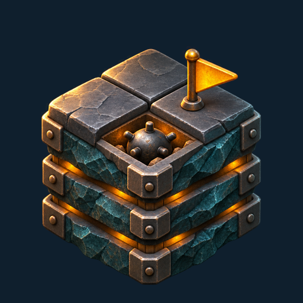

# 三维扫雷 · Mines3D Deep Sector · 1.7.1-haoke.2

[正式版介绍与下载 / Download](https://www.haoke.org/software/491ec4cb67f1146b) · [联机游戏平台 / Online platform](https://cleanbizai.com/games/mines3d)



本次更新：密码框显示“请输入密码”，下方注明“登录后保持登录状态”。首页和联机大厅新增分享游戏、加入 QQ 群 1841958554；支持系统分享、复制链接和 QQ 不可用时复制群号。下载与分享共用用户提供的 https://www.haoke.org/software/491ec4cb67f1146b?platform=android ，安装包只在本地交付，未上传游戏网站。

This update clarifies the password placeholder and persistent sign-in, and adds Share game / Join QQ group 1841958554 to Home and the online lobby. System sharing and clipboard fallbacks use the owner-provided link above. Login/session behavior and the signing certificate are unchanged; the APK is delivered locally, not uploaded to the game site.

Android 正式版，build 21。立体矿井、原创爆炸与音效、六种单机模式，以及 2–6 人合作探矿、猎雷淘汰、团队无猜、断层、每日同图和同图竞速；六人还能玩 3v3 撤离。单指旋转，双指缩放和平移，切换当前层点选。新矿井图标与中英文设置/签名更新入口已接入。

Based on Mines3D 1.7.1 by Přemysl Šťastný and contributors, upstream baseline `535b3e547585aca7c10443fd0ce0ea84961ea7c5`. [Upstream](https://github.com/stastnypremysl/Mines3D). GPL-3.0-only, with original attribution retained. Modified through 2026-11-15.

This Android edition adds a real rotatable mine, original effects/audio, six solo modes, 2–6 player online cooperation and competition, and six-player 3v3. Online play uses the existing Haoke game account. The formal package is independent of upstream and QA installations; sign in again, and keep in mind that private local saves do not migrate automatically.

Package `cos.premy.mines.haoke`; version `1.7.1-haoke.2` / 21; Android 4.4+ (API 19), target 36. APK: **14,883,065 bytes**. SHA-256: `a491027d5953d2186b2cae5c102bac4d905cad30ff5219b522fb7fe35358d577`. Release certificate SHA-256: `e1d81e7ee6b53804eb9f9a7d1444882a105aa07e67ccb396019a20aa5d644a7e`.

安装包保持 Android 4.4+；网站的更新通知接口覆盖 Android 5.0+，4.4 用户可手动从网站下载。The APK supports Android 4.4+; the website's update notification policy covers Android 5.0+.

## 游玩

首页有六个独立模式：经典扫雷、矿井撤离、无猜解谜、断层矿井、有限扫描、每日同图。

- 单击实体矿板选格，用底部按钮开格、插旗或取消旗帜。单指旋转；双指缩放和平移；复位按钮还原镜头。拖动结束不执行棋盘操作。
- B1 是物理最高层。箭头上下换层，当前层视图方便进入内部和边角，全局视图显示层叠关系。只有当前层可选。
- 每个数字只统计同层上下左右和紧邻上下层同坐标，最多 6 个邻格。缺失格不参加任何计数、选格或路线。
- 首个实际开格安全。无猜、撤离和每日模式自动打开固定安全起点。经典保留 5/8/10/12/15 五种边长、2–8 层以及原难度雷数；高难度最多 540 雷。
- 除撤离模式外，正确插出全部地雷且没有误旗才获胜；触雷失败。撤离只要求从绿色入口打开一条安全路线至橙色出口。
- 扫描每局两次，只拆分已开数字格的本层/相邻层雷数，不给位置；重新查看同一格不再次扣次。提示先高亮相关格，第二次点击说明推理。
- 音效开关和减弱闪光/震屏位于设置。简中与英文随系统首选语言选择。

## 模式

| 模式 | 内容 |
|---|---|
| 经典 | 原有五种尺寸、难度、插旗判胜；零格跨层展开可在设置中启用。 |
| 矿井撤离 | 竖井初探、路线取舍、断层绕行三关；末关必须借中层缺口穿过断层。 |
| 无猜解谜 | 三个固定起点关卡，公开数字求解器验证；提示不接收隐藏雷位。 |
| 断层矿井 | 缺角、中央空洞、错层三种真实拓扑。 |
| 有限扫描 | 经典规则，每局两次数字拆分扫描。 |
| 每日同图 | 设备本地日历日期，v1 日期种子，固定安全起点；同日重试不换图，保存上次用时、误标、提示和最佳通关用时。离线模式，无服务器排行榜。 |

无猜和每日模式自动展开零格；撤离逐格开路。首次布雷前的旗帜保留。所有模式共用 `MinesContainer / BoardMoves / BoardDefinition`。

## 恢复与声画

每个 Activity 拥有 `LoadedGame`。Android Bundle 和应用私有检查点保存模式定义、种子/日期、缺失格、雷位、旗帜、当前层、用时、扫描、提示、选择、镜头及爆炸阶段。主页可继续上次对局。后台不计时、不播放声音；已结束的爆炸不会再次从起爆开始。重试固定关卡/每日图保持布局；经典、扫描与断层重试重新布雷。

`ExplosionState` 与对局计时分开：视觉扬尘约 6 秒，完整声音尾音 10 秒。失败后延迟结算，让爆点和受损格可见。声音使用原创分轨导出的静态 AudioTrack、短操作音 SoundPool 和环境 MediaPlayer，处理音频焦点与生命周期。

## 场景与原件

- `art/mine_scene/Mines3D_DeepSector.blend`：已确认的可编辑 Blender 场景，原文件保持不变。
- `art/mine_scene/textures`、`audio`、`fonts`：原始贴图、独立音效、六条分轨、字体及许可。
- `art/mine_scene/scripts/export_android.py`：导出原几何至现有 GLES2 的 M3D2 顶点模板。大型棋盘使用简化倒角，数字保留 Noto 字形。
- `art/mine_scene/scripts/bake_mobile_dust.py`：把原场景 13 团矿尘烘为 16 帧透明图集。手机端使用插值图集，不运行 Cycles 体积解算。
- `art/mine_scene/scripts/prepare_android_assets.py`：原始贴图和声音的运行时转换；生成 Noto Sans SC Medium 静态字体。
- `app/src/main/assets/mine`：完整运行时模型、贴图、字体、图集和音频。

手机保持实时透视、旋转、点选与碎片；灯光用 GLES2 方向光、暖色局部光与爆点闪光适配，不能与 Cycles 逐像素等同。碎片使用有重力、板面/栏杆/近侧支柱碰撞的有限实例；尘土是从原体积动画烘焙的透明图集。点选用实际矿板/旗帜三角形，实体支架遮挡会阻止穿透选格。无 GLES2 或渲染失败时，保留同一对局与操作控件，进入平面兼容视图。

Noto Sans / Noto Sans SC 使用 SIL OFL 1.1，允许商用，许可随源文件交付。矿井美术与音效由本项目脚本原创生成，未使用第三方付费声音或模型。程序按 GPL-3.0-only 分发，字体按其独立 OFL 许可。

## 联机 / Multiplayer

从首页进入「联机探矿」，登录后创建好友房或公开匹配。2–6 人核心模式不补电脑；所有人准备后由房主开始。合作打开入口到出口的六邻格安全路线，队友共享扫描和救援。猎雷每人 15 秒，先确认 3 颗雷或最后存活者获胜，误判或踩雷淘汰。其他玩法包括团队公开推理、四种断层、北京时间每日挑战、同图竞速及六人 3v3。切后台不暂停队友对局；60 秒内可以重连。

Open Online expedition, sign in, then create a friend room or match publicly. Core modes accept 2–6 real players; 3v3 requires six. Cooperation connects entrance to exit with scans and rescues. Mine hunt uses 15-second turns, verified mine claims and elimination. Online matches keep advancing while you are away; reconnect within 60 seconds. Solo saves and timing remain independent.

## 构建 / Build

See [build, signing and asset instructions](docs/release/BUILD.md). Set JDK 21 `JAVA_HOME` and Android SDK 36 `ANDROID_HOME`, then run:

```text
gradlew assembleRelease
gradlew testReleaseUnitTest --tests "cos.premy.mines.updates.*"
```

The Gradle release output is unsigned; the publisher's private signing key is deliberately not included. `assembleDebug` builds an independent QA package. On Windows, an ASCII drive mapping may be needed for a Chinese source path. This repository includes all Android sources, editable Blender/texture/audio/icon originals, and `platform/haoke-game-platform` with the matching server and frontend sources. No live user database, credentials or private signing material is included.

## 实际验证 / Verification

[Detailed scope and limits](docs/release/VERIFICATION.md). Build 21 compilation, lint and signature/package checks passed, including the packaged bilingual copy and owner-provided links. The 28 updater checks and one feed check passed previously in build 20 and were not rerun for these UI additions. Prior QA.5 included 32 game JVM checks, 107 isolated backend checks, one phone plus one emulator cooperation, maximum-board checks and companion-client mode checks.

用户已明确选择自行完成剩余测试，本轮未重新运行游戏或真机测试。正式包真机安装/升级/更新界面、部署后公网双端完整对局、六台真机、弱网/负载、低端手机及完整 10–15 分钟真机长测未验证。Historical QA evidence is not a formal-device pass; those acceptance items remain unverified.

[Privacy / 隐私](privacy-policy.md) · [GPL licence](LICENSE) · [runtime media licences](app/src/main/assets/mine) · [icon master and design prompt](art/launcher/DESIGN.md)
